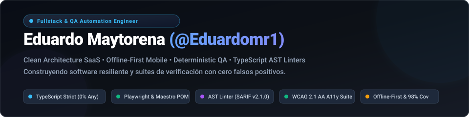

<picture>
  <source media="(prefers-color-scheme: dark)" srcset="./assets/header-dark.svg">
  <source media="(prefers-color-scheme: light)" srcset="./assets/header-light.svg">
  
</picture>

 

[-0ea5e9?style=for-the-badge&logo=googlemaps&logoColor=white)](https://maps.google.com)

 

[-3178C6?logo=typescript&logoColor=white)](https://www.typescriptlang.org/)

---

## 👨‍💻 About Me

I work in **software engineering & quality assurance** and build the applications I test. I come from the side that breaks systems, and that changes how I design and write code: every non-trivial piece leaves a test that covers it, and limitations are written down and benchmarked instead of discovered in production.

My engineering philosophy: **quality, reliability, and accessibility are not late-stage checkboxes or reactive fixes; they are foundational architectural invariants**. I enforce this through strict typing (0% `any`), abstract syntax tree (**AST**) static analysis, deterministic contract testing, automated accessibility audits (**WCAG 2.1 AA**), and zero-flakiness **CI/CD** pipelines.

---

## 🔄 The Full Engineering Cycle: Break, Report, Fix, Verify

> *"Find the defect with evidence, design the architectural fix, prove resolution with a regression test."*

My repositories are intentionally interconnected to demonstrate the complete lifecycle of software:
1. **The Application:** Built with strict contracts, clean separation of concerns, and defensive data modeling.
2. **The QA Framework:** Stress-tests the application via automated E2E suites, network chaos simulations, and contract assertions.
3. **The Proof:** Deficiencies discovered during exploratory testing (such as case-sensitive login lockouts, un-optimistic UI toggles, or floating-point rounding errors) aren't just patched—they leave behind permanent automated regression tests and architectural documentation preventing their recurrence.

---

## 🚀 Featured Projects & Systems

### 🛠️ Developer Tooling, AST Linters & AI Security

#### 1. 🛡️ [Vigía](https://github.com/Eduardomr1/vigia) · TypeScript AST Linter & GitHub Action
> **Static analysis tool built on the TypeScript Compiler API that audits test suites to eradicate hollow tests, false positives, and orphaned assertions.**

* **Semantic AST Traversal:** Inspects real call expressions across Jest, Vitest, Playwright, and Cypress rather than relying on brittle regex pattern matching.
* **8 Critical Diagnostic Rules:** Detects tests without assertions, orphaned `expect()` calls without matchers, asynchronous promises missing `await`, silent `try/catch` assertion swallows, and literal tautologies (`expect(true).toBe(true)`).
* **Orphan Selector Detection:** Cross-checks negative assertions (`queryByTestId`) against production codebase IDs to catch tests passing due to typos rather than real logic.
* **GitHub Code Scanning:** Exports native *OASIS SARIF v2.1.0* reports for automated inline Pull Request annotations and diff-only checks.

#### 2. 🤖 [AgentGuard](https://github.com/Eduardomr1/agentguard) · LLM Prompt & Output Security Auditor
> **Lightweight CLI and TypeScript library designed to safeguard LLM interactions against prompt injection attacks, secret/PII exfiltration, and schema non-compliance.**

* **Prompt Injection Detection:** Multi-pattern behavioral and delimiter analysis identifying jailbreaks, system-prompt override attempts, and instruction hijackings.
* **PII & Credential Scrubbing:** Real-time regex and entropy scanning targeting API keys, tokens, emails, phone numbers, and payment details before hitting model inference.
* **Structured Output Validation:** Validates generative LLM payloads strictly against pre-defined JSON Schemas, guaranteeing reliable backend downstream ingestion.

---

### ⚡ Systems Engineering, High Performance & Observability

#### 3. 💾 [RESP Key-Value Store](https://github.com/Eduardomr1/resp-kv-store) · In-Memory Engine (Redis Compatible)
> **Zero-dependency, production-grade in-memory key-value database engine implementing the Redis Serialization Protocol (RESP2) over TCP sockets in TypeScript.**

[-059669)](https://github.com/Eduardomr1/resp-kv-store)

* **Polymorphic In-Memory Storage:** Full support for Strings, Lists, Hashes, Sets, and Sorted Sets powered by custom probabilistic **SkipList** and dictionary structures.
* **Durability & Snapshots:** Append-Only File (**AOF**) with atomic background rewriting (`BGREWRITEAOF`), along with point-in-time **RDB binary serialization** with CRC64 checksum integrity.
* **Advanced Engine Capabilities:** ACID-like transactions (`MULTI`/`EXEC`/`WATCH`), pub/sub messaging hub, master-replica replication with ring-buffer backlog (`PSYNC2`), probabilistic **HyperLogLog** cardinality, and big-endian Bitmaps.
* **Deterministic Eviction:** Configurable memory governor supporting LRU, Morris probabilistic LFU with temporal decay, and volatile-TTL pool sampling.

#### 4. 📡 [PulseTrack](https://github.com/Eduardomr1/pulsetrack) · API Observability & Uptime Engine
> **Real-time API uptime, latency & health observability platform featuring Clean Architecture, Next.js 15, Drizzle ORM, and SRE error budget telemetry.**

* **Distributed Synthetic Probing:** Non-blocking async execution monitoring REST endpoints, response codes, and TLS certificate expiration with sub-millisecond resolution.
* **Statistical Latency Telemetry:** Quantile analysis (P50, P90, P99), jitter computation, and early warning triggers before SLA breaches occur.
* **Flapping Control & Webhook Dispatch:** Intelligent multi-channel alert delivery with hysteresis stabilization windows to eliminate notification fatigue during transient blips.

---

### 📱 Fullstack & Mobile Engineering

#### 5. 📱 [Control de Gastos](https://github.com/Eduardomr1/control-de-gastos) · Offline-First Mobile Engineering
> **High-precision mobile personal finance manager for iOS & Android with synchronous offline mutation queues and 60 FPS native micro-interactions.**

[-059669)](https://github.com/Eduardomr1/control-de-gastos)

* **Offline-First Resilience:** In-memory FIFO mutation queue with synchronous disk persistence via *MMKV* that survives OS-level process kills. Synchronizes via idempotent client-side UUIDs to SQLite local cache and PostgreSQL remote via Supabase RPC.
* **Integer Cent Arithmetic:** Eradicates IEEE-754 floating-point rounding errors across all balances by strictly manipulating integer cents (`assertCents`).
* **Deep Dynamic Type Accessibility:** Fluid layout supporting up to 310% system font scaling without container overflow or truncated numerical values.

#### 6. 📅 [AgendaCitas / Reservas](https://github.com/Eduardomr1/agendacitas) · Multi-Tenant Clean Architecture SaaS
> **Appointment booking and resource management SaaS platform featuring strict multi-layer Clean Architecture and a deterministic mathematical anti-collision engine.**

[-000000?logo=next.js&logoColor=white)](https://nextjs.org/)

* **Layered Domain Isolation:** Strict boundary segregation: `Domain` (pure business models and use cases), `Data` (Drizzle ORM repository implementations), and `Presentation` (server/client components).
* **Client/Server Barrel Segregation:** Discrete entry barrels (`index.ts` vs `server.ts`) preventing Node.js server modules, database drivers, or environment secrets from leaking into client bundles.
* **Deterministic Anti-Collision Scheduling:** Algorithmic verification of provider working hours, overlapping appointment windows, and atomic booking slots with semantic domain `Failure` handling.

#### 7. 🔍 [Proyectos de Programación](https://github.com/Eduardomr1/proyectos-de-programacion) · REST API + Inverted Index BM25 Engine
> **JWT authenticated REST API in Node.js/Express, responsive React frontend, and a zero-dependency full-text search engine implementing an Inverted Index with Okapi BM25.**

* **BM25 Search Engine:** Custom text tokenizer, stop-word filtering, term-frequency inverted index, and BM25 relevance ranking built from scratch with zero third-party dependencies, benchmarking at up to 593x faster than linear scans.
* **Robust Auth & Security:** Express REST service implementing normalized email handling (case-insensitive login resilience), brute-force attempt throttling, password strength policies, and JWT token authorization.

---

### 🧪 Quality Assurance, Test Automation & Chaos Engineering

#### 8. 🎭 [Proyectos de QA](https://github.com/Eduardomr1/proyectos-de-qa) · Playwright POM, A11y & Network Chaos
> **End-to-end testing framework with Page Object Model, automated accessibility auditing with Axe-Core, and CI-driven API contract tests with Newman.**

[-FF6C37?logo=postman&logoColor=white)](https://www.postman.com/)
[-10b981)](#)

* **Resilient Page Object Model:** Pure encapsulation of DOM locators and workflows into `AuthPage` and `TareasPage`, prioritizing accessible ARIA role selectors (`getByRole`, `getByLabel`).
* **Automated Accessibility Testing:** Runs `@axe-core/playwright` across user flows to enforce WCAG 2.1 AA compliance (contrast ratios, heading hierarchies, keyboard focus management).
* **Network Chaos & Error Simulation:** Mocks backend failures (HTTP 500, 404), network offline cutoffs, and throttled Slow-3G scenarios to verify frontend graceful degradation.
* **Contract Verification:** Newman CLI automation running Postman suites across 25 requests and 96 assertions with rich *htmlextra* reporting in GitHub Actions.

---

## 🛠️ Technology Stack & Toolkit

<table width="100%">
  <thead>
    <tr>
      <th width="25%">Category</th>
      <th width="45%">Technologies & Tools</th>
      <th width="30%">Standards & Focus</th>
    </tr>
  </thead>
  <tbody>
    <tr>
      <td><b>Languages & Runtimes</b></td>
      <td>
        
        
        
        
        
      </td>
      <td>Strict TypeScript, 0% <code>any</code>, <code>exactOptionalPropertyTypes</code>, Native ES Modules.</td>
    </tr>
    <tr>
      <td><b>Frontend & Mobile</b></td>
      <td>
        
        
        
        
        
        
        
      </td>
      <td>Feature-First structure, 60 FPS native animations, Server Actions, $\ge 44$px touch targets.</td>
    </tr>
    <tr>
      <td><b>Backend, Data & Storage</b></td>
      <td>
        
        
        
        
        
        
        
        
      </td>
      <td>Offline-first synchronization, synchronous disk queues, idempotent RPCs, strict schema typing.</td>
    </tr>
    <tr>
      <td><b>Testing & QA Automation</b></td>
      <td>
        
        
        
        
        
        
      </td>
      <td>Page Object Model (POM), WCAG 2.1 AA audits, network chaos resilience, 0% flakiness in CI.</td>
    </tr>
    <tr>
      <td><b>Tooling & DevOps</b></td>
      <td>
        
        
        
        
        
      </td>
      <td>AST static analysis, GitHub Code Scanning SARIF, multi-stage Docker builds, parallel CI workflows.</td>
    </tr>
  </tbody>
</table>

---

## 📊 GitHub Analytics

<picture>
  <source media="(prefers-color-scheme: dark)" srcset="https://github-readme-stats.vercel.app/api?username=Eduardomr1&show_icons=true&theme=tokyonight&hide_border=true&bg_color=0d1117&title_color=38bdf8&icon_color=60a5fa&text_color=94a3b8">
  <source media="(prefers-color-scheme: light)" srcset="https://github-readme-stats.vercel.app/api?username=Eduardomr1&show_icons=true&theme=default&hide_border=true&bg_color=f8fafc&title_color=0284c7&icon_color=2563eb&text_color=475569">
  
</picture>
<picture>
  <source media="(prefers-color-scheme: dark)" srcset="https://github-readme-stats.vercel.app/api/top-langs/?username=Eduardomr1&layout=compact&theme=tokyonight&hide_border=true&bg_color=0d1117&title_color=38bdf8&text_color=94a3b8">
  <source media="(prefers-color-scheme: light)" srcset="https://github-readme-stats.vercel.app/api/top-langs/?username=Eduardomr1&layout=compact&theme=default&hide_border=true&bg_color=f8fafc&title_color=0284c7&text_color=475569">
  
</picture>

---

## 📬 Let's Connect

I am open to discussions regarding **Senior Fullstack**, **Lead QA Automation Engineer**, or **Software Architect** roles with teams building robust, high-reliability software.

* 📧 **Email:** [eduardo_maytorenar@outlook.com](mailto:eduardo_maytorenar@outlook.com)
* 🐙 **GitHub:** [github.com/Eduardomr1](https://github.com/Eduardomr1)
* 📍 **Location:** Hermosillo, Sonora, Mexico (MST / UTC-7) — *Available for Remote & Hybrid*
* 💬 **Languages:** Spanish (Native) · English (Professional Working Proficiency)

 

  Engineered with architectural rigor and deterministic verification • GitHub Profile 2026

